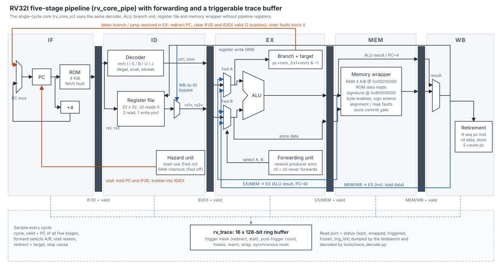

# rv32i-core

A single-cycle and a five-stage pipelined RV32I processor in SystemVerilog, verified against an independent Python ISA model, with a triggerable pipeline trace buffer.



## What is implemented

* Full RV32I base: all 37 instructions plus FENCE (no-op), ECALL and EBREAK, with precise stops for illegal instructions, misaligned and unmapped accesses, and misaligned jump/branch targets. Contract: [docs/spec.md](docs/spec.md).
* Single-cycle core and a five-stage pipeline sharing one decoder, ALU, register file, memory wrapper and retirement format. The pipeline runs with forwarding off (interlock, WB-to-ID bypass) or on (EX/MEM and MEM/WB forwarding, one-bubble load-use). Design notes: [docs/architecture.md](docs/architecture.md).
* A 16-entry trace buffer that records every pipeline stage each cycle and freezes a configurable number of samples after a stall or redirect.
* A regression that builds every program, simulates all three configurations, and compares every retired instruction with the reference model. Coverage: [docs/test_matrix.md](docs/test_matrix.md). Bugs found along the way: [docs/bugs.md](docs/bugs.md).

## Results

Measured on Windows 11 with Icarus Verilog 13.0 and riscv32-esp-elf-gcc 14.2.0 from PlatformIO ([evidence/regression.log](evidence/regression.log)).

| | |
| --- | --- |
| Programs | 48: 38 directed, 10 seeded random (seeds 1-10) |
| Simulations | 149, each compared record by record with the reference model |
| Compared retirement events | 38,109 |
| Mutation check | 13 of 13 injected RTL bugs caught ([evidence/mutation.log](evidence/mutation.log)) |

Cycles for identical retirement streams and signatures:

| Workload | Retired | Single-cycle | Pipeline, forwarding off | Pipeline, forwarding on | Cycle reduction from forwarding |
| --- | ---: | ---: | ---: | ---: | ---: |
| `demo.c` (fill, insertion sort, checksum, `-O2`) | 7,301 | 7,302 | 12,442 | 9,130 | 26.6% |
| 10 random programs | 4,743 | 4,753 | 8,743 | 5,772 | 34.0% |

Cycle reduction = (cycles_off - cycles_on) / cycles_off. Cycle counts depend on the compiler, so `demo.c` built with a different GCC gives different numbers.

## Run it (Windows PowerShell)

```powershell
cd $env:USERPROFILE\Documents\rv32i-core
python tools/run_tests.py
```

The runner finds `iverilog`/`vvp` on `PATH` or in `C:\msys64\ucrt64\bin`, and finds `riscv32-esp-elf-gcc` from PlatformIO. To point it somewhere else:

```powershell
$env:SIM_BIN = 'C:\msys64\ucrt64\bin'
$env:RV_GCC  = Join-Path $env:USERPROFILE '.platformio\packages\toolchain-riscv32-esp\bin\riscv32-esp-elf-gcc.exe'
```

It exits with 0 only when every check passes. Logs and per-test artifacts go to `build/` (ignored by Git); a failing run saves the disassembly, both traces and a waveform under `build/fail/`.

| Command | Purpose |
| --- | --- |
| `python tools/run_tests.py --only smoke,p_loaduse --configs pipe_fwd` | Subset of tests or configurations |
| `python tools/run_tests.py --seeds 11,12,13` | Other random seeds |
| `python tools/run_tests.py --vcd` | Keep a VCD for every simulation |
| `python tools/mutation_check.py` | Inject 13 RTL bugs and confirm each one fails the regression |
| `python tools/make_evidence.py` | Regenerate the waveform and log images (needs `pip install matplotlib`) |
| `python tools/trace_decode.py build/trace/p_loaduse.tdump` | Print a captured trace |

Smoke test by hand:

```powershell
$tools   = Join-Path $env:USERPROFILE '.platformio\packages\toolchain-riscv32-esp\bin'
$gcc     = Join-Path $tools 'riscv32-esp-elf-gcc.exe'
$objcopy = Join-Path $tools 'riscv32-esp-elf-objcopy.exe'
New-Item -ItemType Directory -Force build | Out-Null
& $gcc -march=rv32i -mabi=ilp32 -nostdlib -nostartfiles -mno-relax '-Wl,--no-relax' -T firmware/link.ld -o build/smoke.elf firmware/smoke.S
& $objcopy -O binary build/smoke.elf build/smoke.bin
python tools/mkhex.py build/smoke.bin build/smoke.hex
iverilog -g2012 -Wall -s core_tb -o build/smoke.vvp -f sim/files.f
vvp build/smoke.vvp
gtkwave build/smoke.vcd
```

Add `-P core_tb.PIPELINE=1 -P core_tb.FORWARD=0` (or `1`) to the `iverilog` line for the pipeline.

## Evidence

| Image | Shows |
| --- | --- |
| [01-datapath.svg](evidence/01-datapath.svg) | Pipeline datapath, bypass paths, hazard and redirect control, trace tap points |
| [02-smoke-wave.png](evidence/02-smoke-wave.png) | Smoke test on the single-cycle core: store of `0x0000000c` to `0x80000000`, EBREAK |
| [03-load-use-wave.png](evidence/03-load-use-wave.png) | Load-use hold, EX bubble, and MEM/WB forward giving `x6 = 42` |
| [04-branch-flush-wave.png](evidence/04-branch-flush-wave.png) | Taken branch clearing IF/ID and ID/EX; the wrong-path store never commits |
| [05-regression.png](evidence/05-regression.png) | Regression command, counts, and result |
| [06-trace-demo.png](evidence/06-trace-demo.png) | Decoded trace capture triggered on a stall, plus the forwarding cycle comparison |

The VCDs behind the waveform images are in `evidence/` as well.

## Layout

```text
rtl/        processor, decoder, ALU, branch unit, register file, memory wrapper, trace buffer
sim/        self-checking testbenches and source list
firmware/   smoke test, directed tests, C demo, startup code, linker script
tools/      ROM conversion, reference model, random generator, regression, trace decoder, evidence
docs/       spec, architecture, test matrix, bugs
evidence/   images, logs, VCDs
```

No FPGA build has been done. All code in this repository is original; no third-party sources are included.
