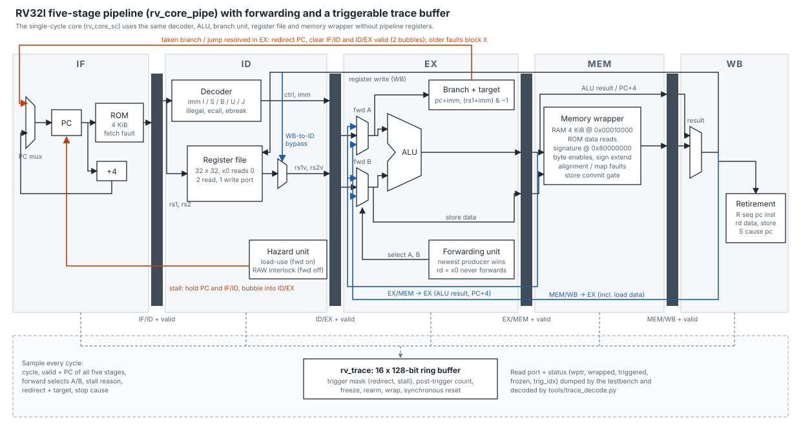

# Architecture

## Modules

| File | Role |
| --- | --- |
| `rtl/rv_pkg.sv` | Opcodes, ALU ops, stop causes, mux encodings |
| `rtl/rv_decode.sv` | Full RV32I decode with strict `funct3`/`funct7` checks, separate I/S/B/U/J immediate builders |
| `rtl/rv_alu.sv`, `rtl/rv_branch.sv` | ALU (10 ops) and branch comparator |
| `rtl/rv_regfile.sv` | 2 read / 1 write, `x0` hardwired to zero on both read ports, writes to `x0` ignored |
| `rtl/rv_mem.sv` | ROM, RAM, signature register, alignment and map checks, byte lanes, sign extension |
| `rtl/rv_core_sc.sv` | Single-cycle core |
| `rtl/rv_core_pipe.sv` | Five-stage core, `FORWARD` parameter selects interlock-only or full forwarding |
| `rtl/rv_trace.sv` | Triggerable trace ring buffer |
| `rtl/rv_top.sv` | Memory wrapper plus the selected core (`PIPELINE` parameter) and, for the pipeline, the trace buffer |

Both cores share the decoder, ALU, branch unit, register file, memory wrapper, and retirement format, so the reference comparison checks them against one contract.

## Single-cycle core

Fetch, decode, execute, memory, and writeback happen in one clock. ROM and RAM reads are combinational; the register file, RAM, signature register and PC update on the rising edge. Every architectural write is gated on `ret_valid = active && cause == NONE`, so a faulting instruction never writes a register or memory.

## Five-stage pipeline

IF, ID, EX, MEM, WB with a valid bit in every pipeline register. Register writes and store commits are gated on the owning stage's valid bit.

| Hazard | `pipe_nofwd` | `pipe_fwd` |
| --- | --- | --- |
| ALU result needed by the next 1-2 instructions | Hold IF and ID, bubble into EX until the producer reaches WB | Forward from EX/MEM (newest) or MEM/WB |
| Producer in WB, consumer in ID | WB-to-ID bypass in the register read path | Same |
| Load followed by its consumer | Interlock as above | One stall, then forward the load data from MEM/WB |
| Store data depending on a recent result | Interlock | Forwarded on the rs2 path into EX/MEM |
| Producer writes `x0` | Never stalls | Never forwards, never stalls |
| Taken branch / jump | Resolved in EX, PC redirected, IF/ID and ID/EX cleared: 2 bubbles | Same |

Writeback-to-decode is a bypass, not a hold. I chose it because it removes a third interlock cycle in both modes and costs one comparator and mux per read port.

### Precise stops

A stop cause travels with its instruction: fetch faults and illegal/ECALL/EBREAK are attached in ID, misaligned branch targets in EX, load/store faults in MEM. The stop is reported only when the instruction reaches WB. While an older instruction with a cause sits in MEM, everything younger in EX, ID and IF is invalidated and EX cannot redirect the PC. While it sits in WB, MEM is also invalidated and no store commits. The core then halts. Result: the oldest stop wins, younger instructions leave no register write, store, retirement, or redirect.

The WB-stage store gate is redundant with the MEM-stage kill (every stop passes through MEM first), so removing it alone is not observable. The MEM-stage kill is checked by the `p_fault_*` tests, which require zero redirects after an older fault.

## Memory timing

Combinational ROM and RAM reads keep both cores simple and give the one-bubble load-use behavior. They map to distributed RAM or registers, not synchronous block RAM. An FPGA build with block RAM needs an extra fetch stage or a wait cycle. This project has not been synthesized or run on a board.

## Retirement interface

`ret_valid` plus the record fields are valid for one cycle and sampled on the rising edge that commits them. The single-cycle core drives them combinationally. The pipeline drives them from the MEM/WB register; store fields are captured when the store commits in MEM. `stop_valid` carries the cause and PC of the stopping instruction. The testbench writes both to a text trace that `tools/run_tests.py` compares line by line with `tools/refmodel.py`.

## Trace buffer

`rv_trace` stores one 128-bit sample per cycle in a 16-entry ring:

| Bits | Field |
| --- | --- |
| 127:112 | cycle counter (low 16 bits) |
| 111:107 | valid bits IF, ID, EX, MEM, WB |
| 106:27 | low 16 bits of the five stage PCs (0 when the stage is empty) |
| 26:23 | forwarding select A, B (0 register, 1 EX/MEM, 2 MEM/WB) |
| 22:21 | stall reason (1 load-use, 2 RAW interlock) |
| 20 | redirect |
| 19:4 | redirect target |
| 3:0 | stop cause |

Configuration: `cfg_mask` bit 0 triggers on a stall, bit 1 on a redirect. The first matching sample is the trigger; the buffer then records exactly `cfg_post` more samples and freezes (`cfg_post` = 0 freezes on the trigger sample; keep it below the depth so the trigger stays in the buffer). `rearm` clears the trigger and frozen flags and keeps the write pointer; the rearm cycle is not captured. Reset clears the pointer, wrap flag, and trigger state. The read port and status flags let the testbench dump the buffer, and `tools/trace_decode.py` prints it oldest first.

The trace buffer only observes; enabling it does not change timing. The cycle comparison in the README is forwarding off vs on, with identical retirement streams and signatures.
